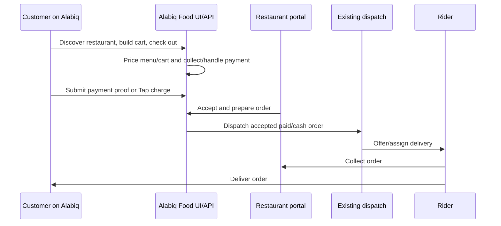
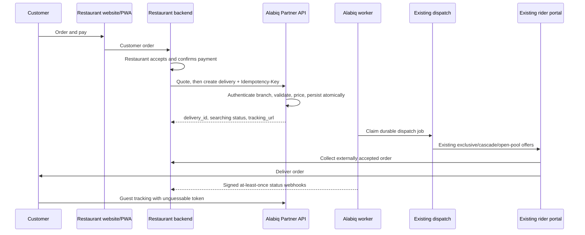

# Restaurant Delivery Service Provider Plan

- **Status:** implementation plan only — no runtime code is changed by this document
- **Target:** convert Alabiq Food Delivery from an Alabiq-owned customer marketplace into a delivery-as-a-service API for restaurant-owned websites and PWAs
- **Architecture:** small modular monolith first; horizontally scalable without per-restaurant services
- **Primary implementation root:** `alabiq-web-main/`

---

## 1. Instructions for the AI implementation tool

1. Implement this plan in the phases in section 16. Do not implement all phases in one change.
2. Read every target file before editing it. Make targeted edits; preserve existing conventions and error handling.
3. Backend remains Node.js, Express, plain CommonJS, with no build step. Frontend remains React ESM/JSX.
4. Preserve layering: `routes/` → `controllers/` → `lib/` → `repositories/`. Controllers contain HTTP adaptation only; only `lib/config.js` reads `process.env` directly.
5. Add PostgreSQL migrations after the applied `0001`–`0007` baseline. Never edit an applied migration and never drop historical commerce tables during initial cutover.
6. Do not add a dependency, microservice, Kubernetes, Kafka, PostGIS, or a second dispatch stack. If a dependency appears necessary, stop and request approval.
7. Keep marketplace behavior available behind its legacy flag until the deletion gates in section 19 pass.
8. After backend logic changes, run the backend tests. After frontend changes, run the frontend build and available tests. Run Docker integration and load tests at the phases specified below.
9. Do not SSH to production, deploy, enable production flags, rotate production secrets, or delete production data unless the owner explicitly requests that action.
10. Update `AGENTS.md`, `alabiq-web-main/DOCKER.md`, and `DEPLOYMENT-PLAN.md` when architecture, environment variables, services, or deployment behavior actually change.

---

## 2. Goal and ownership boundaries

### Target flow for every onboarded restaurant branch

1. A customer orders and pays on the restaurant's own website or PWA.
2. The restaurant accepts the order in its own system.
3. The restaurant backend calls Alabiq's authenticated Partner API.
4. Alabiq validates the externally paid order, calculates the delivery fee, persists the order and delivery atomically, and starts rider search.
5. A rider accepts, travels to the restaurant branch, collects the order with pickup proof, and delivers it with delivery proof.
6. Alabiq sends signed status webhooks to the restaurant and exposes token-based guest tracking.

### Alabiq owns

- Partner authentication, restaurant/branch status, and API authorization.
- Delivery quotes and server-side delivery-fee calculation.
- Delivery persistence, dispatch, rider offers, rider assignment, pickup/delivery state, and proof.
- Rider location ingestion and authorized operational tracking.
- Partner webhooks, guest delivery tracking, operational oversight, and audit records.

### Restaurant owns

- Customer identity, menu, cart, food pricing, ordering UI, kitchen acceptance, and preparation.
- Customer payment collection and payment refunds for the restaurant sale.
- Customer support for menu, food, and restaurant-payment issues.
- Calling Alabiq only after restaurant acceptance and confirmed external payment.

### Explicit MVP assumptions

- One API credential is bound to exactly one merchant/branch row and one authoritative pickup location. A restaurant group with branches receives separate credentials.
- The customer does not need an Alabiq account. Existing nullable `orders.customer_id` supports external/guest orders.
- MVP accepts only restaurant-confirmed, externally paid orders. Cash on delivery, Alabiq-collected food payments, restaurant settlement, and refund orchestration are deferred until their accounting contract is defined.
- The restaurant pays Alabiq's delivery fee under a separate settlement arrangement. The API never trusts a partner-supplied delivery fee.
- Restaurant websites/PWAs are external systems. This project supplies their API contract and integration documentation, not a new website per restaurant.
- Alabiq starts searching immediately after accepted order creation. Optional `preparing`/`ready` updates inform operations but do not create another dispatch.

### Non-goals for the first release

- Microservices per restaurant, multi-region active-active deployment, or a new rider app.
- Replacing the existing offer → cascade → open-pool dispatch mechanism.
- COD, automated restaurant payouts, food refunds, or a new accounting platform.
- Exact rider tracking after delivery completion or tracking riders who are off shift.

---

## 3. Current flow versus target flow

### Current flow to replace gradually



### Target flow



The critical change is ownership of checkout and restaurant acceptance, not the rider/dispatch engine.

---

## 4. Reuse strategy

Retain and harden these existing capabilities:

- `backend/lib/dispatch.js`: exclusive offers, cascade, open pool, CAS claiming, and dispatch watchdog behavior.
- `backend/repositories/dispatchRepository.js`: candidate selection and offer persistence; optimize rather than replace.
- `backend/controllers/driverDispatchController.js` and existing driver routes: rider assignment, pickup/delivery proof, geofencing, cancellation, and reclaim.
- Rider UI under `frontend/src/portal/driver/`, including `DriverPage.jsx` and `DriverDispatch.jsx`.
- `orders`, `deliveries`, `dispatch_offers`, order items/payments, proof photos, MinIO, and the double-entry ledger where applicable.
- Dedicated realtime service and Redis pub/sub for SSE fan-out.

Do not create parallel `partner_orders`, a second rider-offer system, or a second delivery status engine. A partner delivery is an `orders` + `deliveries` aggregate with an external source and integration metadata.

---

## 5. Versioned Partner API contract

Base path: `/api/v1/partner`

All writes require a JSON body, a partner credential, and a request ID. Creation additionally requires `Idempotency-Key`.

### Endpoints

| Method | Path | Purpose |
|---|---|---|
| `POST` | `/delivery-quotes` | Price a delivery for the authenticated branch and drop-off. |
| `POST` | `/deliveries` | Create an already accepted, externally paid restaurant order and request dispatch. |
| `GET` | `/deliveries/:id` | Read current delivery state for the authenticated branch only. |
| `POST` | `/deliveries/:id/cancel` | Cancel before pickup, subject to state rules. |
| `POST` | `/deliveries/:id/preparation` | Optional update: `preparing` or `ready`; never dispatches twice. |
| `POST` | `/deliveries/:id/tracking-token/rotate` | Optional but recommended if a tracking URL leaks; revokes the old token. |

Public guest tracking uses a separate unauthenticated-token endpoint, for example `GET /api/public/deliveries/:trackingId?token=…`. It must not expose the Partner API or allow order-code-only access.

### Authentication

```http
Authorization: Bearer ak_live_<credential-id>.<high-entropy-secret>
Idempotency-Key: <64–128 character restaurant-generated unique value>
X-Request-Id: <restaurant request correlation ID>
Content-Type: application/json
```

- Generate at least 256 bits of random secret with Node `crypto`.
- Store only a keyed/hash representation for API-key lookup and verification; store a non-secret key prefix for support identification.
- Resolve `merchant_id` and pickup location exclusively from the authenticated credential. Never trust a request-body `merchant_id` as authority.
- Support two overlapping credentials during rotation. Revocation and restaurant suspension take effect on the next request.
- Return `401` for invalid/revoked credentials and `404` for another tenant's delivery ID to reduce ID enumeration.
- Apply Redis-backed per-credential and per-IP limits, a small JSON body limit, TLS-only URLs, and `429` + `Retry-After` on overload.
- Never log raw API keys, tracking tokens, webhook secrets, customer phone numbers, or full addresses.

### Quote request

```json
{
  "external_order_id": "branch1-order-1042",
  "dropoff": {
    "lat": 24.7136,
    "lng": 46.6753,
    "address": "Customer supplied address",
    "instructions": "Optional delivery instructions"
  }
}
```

Pickup comes from the authenticated branch profile. Validate service area, open/suspended status, coordinates, maximum delivery distance, and operating rules using existing server-side logic.

### Quote response

```json
{
  "quote_id": "01J...",
  "external_order_id": "branch1-order-1042",
  "currency": "SAR",
  "delivery_fee_minor": 1800,
  "expires_at": "2026-11-13T03:20:00.000Z"
}
```

- All API money values are integer minor units plus ISO currency; never accept floating-point riyals.
- Quotes expire after a short configured period, initially 10 minutes.
- Bind a quote to the branch, external order ID, normalized drop-off, fee, and expiration.
- Creation recomputes/validates the quote and consumes it in the creation transaction. A quote cannot fund a different address or multiple orders.
- An idempotent replay still returns the original creation result even if its quote has since expired.

### Delivery creation request

```json
{
  "external_order_id": "branch1-order-1042",
  "quote_id": "01J...",
  "customer": {
    "name": "Customer name",
    "phone": "+9665..."
  },
  "dropoff": {
    "lat": 24.7136,
    "lng": 46.6753,
    "address": "Customer supplied address",
    "instructions": "Call on arrival"
  },
  "items": [
    { "name": "Meal", "quantity": 2 }
  ],
  "merchandise_total": {
    "amount_minor": 8500,
    "currency": "SAR"
  },
  "external_payment": {
    "status": "paid",
    "reference": "restaurant-payment-reference"
  },
  "preparation_status": "accepted"
}
```

Validation rules:

- `external_order_id`: non-empty, bounded length, unique within the merchant/branch tenant.
- `external_payment.status`: MVP accepts `paid` only. A reference is recommended for reconciliation.
- Phone: normalize and validate to the supported region/format; never silently accept malformed contact details.
- Coordinates: finite numbers, latitude `[-90, 90]`, longitude `[-180, 180]`, plausible service-area location.
- Strings and item arrays: explicit length/count limits; reject unknown critical fields or document forward-compatible ignore behavior consistently.
- Items are informational snapshots, not repriced Alabiq menu products.
- The server derives the delivery fee. `merchandise_total` is reporting/snapshot data, not an instruction to collect money.
- Map existing `subtotal`, `delivery_fee`, and `total` fields through one documented adapter. Add `payment_collection = 'restaurant'` so reports cannot confuse restaurant-collected merchandise value with Alabiq-collected revenue.
- Extend payment constraints deliberately, for example `payment_method = 'external'` and `payment_status = 'paid'`; do not relabel STC Pay, Tap, or cash records.

### Creation responses

Initial success is `201 Created`; a completed idempotent replay returns the stored original status/body according to the chosen contract and includes `Idempotent-Replayed: true`.

```json
{
  "delivery_id": "8c0f...",
  "order_id": "3c7a...",
  "external_order_id": "branch1-order-1042",
  "status": "searching",
  "delivery_fee": { "amount_minor": 1800, "currency": "SAR" },
  "tracking_url": "https://alabiq.com/track/delivery/...?token=...",
  "created_at": "2026-11-13T03:10:00.000Z"
}
```

The response is committed with the order, not regenerated after a crash. Because it contains a tracking secret, persist any idempotency response containing that secret encrypted at rest, while retaining only the tracking-token hash for public authorization.

### Status response

Include only partner-relevant fields:

- IDs, external reference, current status/substatus, timestamps, delivery fee, and cancellation reason.
- Pickup/drop-off snapshots needed for reconciliation.
- Rider display name and limited contact/location data only while operationally necessary.
- Proof URLs only through authorized, expiring access; never make private MinIO objects public.

### Cancellation

`POST /deliveries/:id/cancel` accepts a bounded reason and its own `Idempotency-Key`.

- Allowed before `picked_up`, including `searching` and `assigned`.
- Reject after pickup with `409 cancellation_not_allowed`; an assigned rider may already possess the food.
- Use row locks/CAS so cancellation and pickup cannot both succeed. Whichever transaction commits first determines the valid result.
- Notify the assigned rider and stop future offers. Do not erase proof, payment, or audit records.
- Post-pickup returns/disposals require a later, explicit support workflow; do not silently reverse delivery state.

### Error envelope

```json
{
  "error": {
    "code": "quote_expired",
    "message": "The delivery quote expired; request a new quote.",
    "request_id": "01J..."
  }
}
```

Stable codes include `invalid_request`, `unauthorized`, `restaurant_suspended`, `outside_service_area`, `quote_expired`, `quote_mismatch`, `quote_already_used`, `idempotency_conflict`, `external_order_exists`, `request_in_progress`, `not_found`, `invalid_state`, `cancellation_not_allowed`, `rate_limited`, and `service_unavailable`.

Do not expose SQL errors, stack traces, other tenants' IDs, or raw internal exceptions.

---

## 6. Delivery state machine

### External states

```text
searching
  ├─→ assigned → picked_up → delivered
  ├─→ searching (offer declined/expired/reclaimed; substatus explains why)
  └─→ cancelled (before pickup)

assigned ─→ cancelled only when cancellation wins the pickup race
picked_up ─→ delivered; post-pickup cancellation is rejected
```

- Creation maps to restaurant-accepted order state and `deliveries.status = 'searching'`.
- `assigned`, `picked_up`, `delivered`, and `cancelled` reuse existing delivery/rider transitions.
- `preparing` and `ready` are order preparation substates, not new delivery records.
- No available riders does not fail creation. Keep `searching` with `substatus = 'no_riders'` or `'search_exhausted'`, retry within a defined search window, emit a webhook, and allow partner cancellation or an operational retry.
- A rider going offline triggers existing reclaim/re-dispatch behavior; it must not create a second active delivery.
- Terminal state is immutable except for explicitly audited administrative corrections.
- After `delivered` or `cancelled`, stop offers, stop customer rider-location exposure, stop routine rider tracking for that delivery, and expire tracking access after a short configured support window.

### Transition requirements

- Every transition validates its allowed predecessor in the repository/database update predicate.
- Use `UPDATE … WHERE status = expected` or a version column and verify affected-row count.
- Store status timestamps and actor (`partner`, `rider`, `admin`, `worker`) for audit.
- Webhook events reflect committed transitions only, never in-memory intent.

---

## 7. Additive persistence design

Implementation must inspect the live migration baseline before choosing final column names. Proposed new structures:

### `partner_api_credentials`

- `id`, `merchant_id`, `name`, `key_prefix`, `secret_hash`.
- `created_at`, `expires_at`, `revoked_at`, `last_used_at`, `created_by`.
- Index active credentials by prefix; enforce tenant/branch association.

### `delivery_quotes`

- `id`, `merchant_id`, `external_order_id`, normalized pickup/drop-off snapshot.
- `delivery_fee_minor`, `currency`, pricing-rule/version snapshot.
- `request_hash`, `expires_at`, `consumed_at`, `consumed_by_order_id`.

### Order/delivery additions

- `orders.source` (`alabiq_marketplace` or `restaurant_partner`).
- `orders.external_order_id`.
- `orders.payment_collection` (`alabiq`, `restaurant`).
- Any approved external payment method/status extension.
- Encrypted idempotency response reference and tracking-token hash/expiry/revocation fields, or equivalent separate tables.
- Unique `(merchant_id, external_order_id)` for partner-sourced orders.
- Preserve the existing unique `deliveries.order_id` invariant.

### `partner_idempotency_keys`

- `credential_id`, `key`, operation, canonical `request_hash`.
- State (`in_progress`, `completed`, `failed_retryable`), HTTP status, encrypted response body where needed.
- Resource ID, created/expiry timestamps.
- Unique `(credential_id, operation, key)`.

Retention must cover the restaurant's retry window; start at 24 hours or longer. Expired-key behavior must be documented. Never use the current process-local 10-minute/1000-entry middleware for partner writes.

### `background_jobs`

- `id`, `kind`, deduplication key, payload, run-at timestamp.
- `attempts`, `lease_owner`, `lease_expires_at`, `completed_at`, `last_error`.
- Unique `(kind, deduplication_key)` for one dispatch per delivery.

This table supports dispatch requests and other reliable internal work. Redis is not the authoritative order queue.

### `webhook_endpoints`, `webhook_events`, and `webhook_delivery_attempts`

- Endpoint: tenant, HTTPS URL, encrypted signing secret, enabled/revoked timestamps.
- Event: immutable event ID, tenant, order/delivery ID, monotonically increasing per-delivery sequence, type, payload, creation time.
- Delivery state: next attempt, attempt count, lease, delivered/dead-letter timestamps, last HTTP/error category.
- Attempt audit: response status, bounded error message, duration, timestamp.

### `driver_location_current` plus existing history

- One current row per rider, last valid fix, accuracy, source timestamp, ingestion timestamp.
- Retain existing `driver_locations` history for fallback/audit; add appropriate rider/time indexes.
- Only sample history; do not write every 4-second ping to PostgreSQL by default.

All migrations must be additive, reversible at the application-flag level, and tested against a copy of realistic existing data.

---

## 8. Atomic creation, idempotency, and dispatch

### Creation transaction

Within one PostgreSQL transaction:

1. Authenticate and resolve the active branch before entering the transaction.
2. Acquire a transaction-scoped advisory lock derived from credential + operation + idempotency key; unique constraints remain the integrity backstop.
3. Read/create the durable idempotency record.
   - Same key + same canonical request hash + completed: return the stored result.
   - Same key + different hash: `409 idempotency_conflict`.
   - Same key + in progress after bounded wait: `409 request_in_progress` with retry guidance.
4. Validate and lock/consume the matching quote.
5. Insert the partner order, order-item snapshot, delivery, payment/settlement metadata, and tracking-token hash.
6. Insert exactly one deduplicated `dispatch_request` background job.
7. Insert required committed webhook/outbox events with per-delivery sequence numbers.
8. Store the completed idempotency result and commit.

Return success only after commit. If the commit result is uncertain, the partner retries with the same key and body; it must never create a second order.

### Dispatch worker

- One worker container initially. Claim due jobs using `FOR UPDATE SKIP LOCKED` with a bounded lease.
- Renew or bound leases; a crashed worker's job becomes claimable after lease expiry.
- Reuse existing dispatch functions with explicit idempotent guards. `deliveries.order_id` uniqueness and pending-offer indexes remain backstops.
- Partner jobs are handled only by the new worker path. Legacy marketplace orders remain on the legacy path until scheduler migration/cutover. No order may be visible to both dispatch triggers.
- On completion, mark job and outbox state transactionally. On transient failure, retry with backoff + jitter; on poison input, dead-letter with an actionable error and alert.

### Database failure behavior

- Creation fails closed with a retryable `503`; no dispatch or webhook occurs without a committed order.
- Worker/realtime failure cannot change authoritative delivery state.
- Never acknowledge an order, GPS write, or webhook completion before its required durability condition is met.

---

## 9. Outbound restaurant webhooks

### Events

At minimum: `delivery.searching`, `delivery.rider_assigned`, `delivery.picked_up`, `delivery.delivered`, `delivery.cancelled`, and `delivery.search_exhausted`.

Payload contains `event_id`, `type`, `occurred_at`, `sequence`, `delivery_id`, `external_order_id`, current status/substatus, and event-specific safe fields. The restaurant treats delivery ID + event ID as stable identifiers.

### Signing and verification

```http
X-Alabiq-Event-Id: 01J...
X-Alabiq-Timestamp: 176...
X-Alabiq-Signature: v1=<hex HMAC-SHA256>
X-Alabiq-Delivery-Id: 8c0f...
```

Sign `timestamp + "." + raw_body` with the endpoint secret. Restaurants reject old timestamps, compare signatures in constant time, and deduplicate event IDs. Document key rotation and provide an integration-test endpoint/example.

Encrypt stored webhook secrets with a dedicated environment-managed encryption key using Node crypto; do not reuse password hashes or expose secrets in logs. Return a new secret only during controlled rotation.

### Delivery reliability

- At-least-once delivery; duplicates and out-of-order arrival are expected.
- Restaurant must acknowledge within a short timeout (initial target 5 seconds) with a 2xx response.
- Retry network errors, 408, 429, and 5xx with exponential backoff + full jitter, capped intervals, and a total retry window of approximately 24 hours. Honor bounded `Retry-After` for 429.
- Do not retry most 4xx indefinitely; mark configuration/authorization failure and alert. Allow manual replay after correction.
- After the retry window, mark dead-lettered, retain the event, and expose admin replay.
- Consumers use `sequence` to ignore stale updates and `GET /deliveries/:id` to reconcile missed events.
- Batch/claim webhook jobs with leases so multiple workers do not intentionally duplicate sends; occasional duplicates remain part of the contract.

### SSRF protection

Because endpoints are tenant supplied:

- Require HTTPS and restrict allowed ports.
- Resolve and block loopback, private, link-local, metadata-service, and internal Docker/VPS addresses on every connection; guard against DNS rebinding.
- Disable redirects by default, cap response size, and apply connection/read timeouts.
- Never forward partner credentials or internal headers to webhook URLs.

---

## 10. Guest tracking and realtime authorization

Refactor `frontend/src/portal/food/FoodTrackPage.jsx` into public delivery tracking rather than deleting it.

- Generate at least 256 bits of random tracking token; store only its hash, with expiry and revocation.
- Return the tracking URL to the authenticated restaurant. The restaurant delivers it to its customer.
- Public tracking authorization requires both a non-enumerable tracking ID and valid token. Existing public `fd-order-FD-*` SSE access based only on order code must not be extended to partner orders.
- Return a minimal DTO: delivery status, branch/pickup display information, masked drop-off, rider first name/vehicle details if needed, and current rider location only during an active delivery.
- Remove customer payment references, internal notes, other orders, credential data, and full rider history.
- Use short cache lifetimes/no-store as appropriate, token-specific rate limiting, and token rotation/revocation.
- Stop rider-location updates immediately on terminal delivery; allow only non-location delivery confirmation during the support retention window.
- SSE is an optimization. If realtime/Redis is down, the page falls back to bounded polling with jitter and clearly shows delayed/offline state rather than spinning indefinitely.

Existing `backend/lib/notifications.js` drops notifications when `userId` is null. Therefore external customers require token tracking and restaurant webhooks; do not assume account notifications work for guests.

---

## 11. High-traffic GPS ingestion

### Baseline engineering target, not observed capacity

Support an initial test model of 1,000 active riders sending every 4 seconds: **250 location requests/second**, plus bursts and tracking subscribers.

### Hot path

1. Rider authenticates and can update only its own rider ID.
2. Validate payload size, coordinates, source timestamp, accuracy, and delivery/shift authorization.
3. Use Redis for current state:
   - `rider:location:<id>`: latest fix JSON with TTL, initially 60–90 seconds.
   - `riders:available:geo`: GEO index only for online, dispatch-eligible riders.
   - A small Lua/atomic update rejects stale fixes and updates current + GEO consistently.
4. Return a small response with server time and next recommended ping interval. Do not broadcast every received ping to every client.
5. Sample history approximately every 10 seconds per active rider, batch asynchronously through the worker, and apply backpressure. Location history is sampled telemetry, not an order queue.
6. Broadcast rider location to authorized tracking topics at a limited cadence, initially at most every 8–10 seconds, while retaining existing dispatch-distance needs.

### Validation and stale fixes

- Reject non-finite/out-of-range coordinates, impossible accuracy values, timestamps too far in the future, and fixes older than the latest accepted fix.
- Compare source timestamp to server ingestion time; allow bounded mobile clock skew and record observed skew.
- Flag accuracy worse than the configured dispatch threshold (initial candidate 100 m) as not dispatch-ready rather than treating it as precise.
- Detect implausible jumps using elapsed time, reported accuracy, and a generous maximum-speed threshold. Mark suspect fixes ineligible; do not silently move a rider across the city.
- Expire Redis current/GEO entries by TTL and remove riders from availability when offline, suspended, or no longer on shift.
- Never accept arbitrary rider IDs or allow public submission of rider locations.

### Degraded mode

- If Redis is unavailable, use a throttled PostgreSQL current-location upsert and existing recent-location candidate query. Return a degraded indicator internally and alert.
- If PostgreSQL history sampling is slow, keep the authoritative latest state available, bound buffers, drop old history samples before current state, and emit metrics. Never apply unbounded in-memory backpressure.
- If realtime is unavailable, tracking falls back to polling; dispatch must continue.
- On worker restart, rebuild eligibility from authoritative rider/shift/delivery state plus unexpired Redis fixes; never resurrect stale riders.

### Candidate-query evolution

- First release: Redis GEO for nearby candidates, then authoritative PostgreSQL checks for rider eligibility, vehicle, suspension, existing jobs, and offer rules.
- Keep `dispatchRepository.js` recent-history query as fallback and optimize its indexes; avoid unbounded scans and retain a bounded candidate set.
- Add PostGIS only when measured query volume/service-area complexity justifies it and the owner approves the extension.

---

## 12. Docker and runtime topology

### Initial Compose topology

Keep the existing private PostgreSQL 16, Redis 7, MinIO, realtime, migration, API, and frontend services. Add one `worker` service built from the existing backend image/code:

```yaml
worker:
  build:
    context: ./backend
  command: ["node", "worker.js"]
  env_file:
    - ./backend/.env
  depends_on:
    postgres:
      condition: service_healthy
    redis:
      condition: service_healthy
    migrate:
      condition: service_completed_successfully
  restart: unless-stopped
  # Add an actual healthcheck and conservative CPU/memory limits.
  # Publish no host port.
```

This is a structural example; preserve the real Compose build syntax and existing networking when implementing.

### Scheduler ownership

- Move dispatch/watchdog/reminder/charge intervals currently started in `backend/server.js` into `backend/worker.js` before running multiple API replicas.
- API runs with schedulers disabled; exactly one worker initially runs schedulers and leased jobs.
- Worker healthcheck verifies a recent heartbeat and ability to access required dependencies. A dead worker must restart without losing committed jobs.
- Implement graceful SIGTERM: stop claiming work, finish or release current leases, close PostgreSQL/Redis clients, and exit within the Docker stop grace period.

### Networking and storage

- Keep PostgreSQL, Redis, MinIO, realtime, and worker on the private Compose network.
- Keep API bound to `127.0.0.1:4001:4000` for nginx; do not expose database/Redis/worker ports publicly.
- Preserve persistent volumes `postgres_data`, `redis_data`, and `object_data`; Redis persistence is not a substitute for PostgreSQL job durability.
- Set conservative container CPU/memory limits after measuring the baseline; load tests must detect event-loop and memory pressure.

### Scale path when measurements require it

1. Scale stateless API replicas after removing process-local idempotency, GPS throttling, and schedulers.
2. Add a second worker using `SKIP LOCKED` leases; scale dispatch and webhook pools separately only if metrics justify it.
3. Scale SSE realtime behind nginx with Redis pub/sub and connection-aware load balancing.
4. Add managed PostgreSQL backups, pool tuning/PgBouncer, location-history partitioning, and read replicas only from measured need.

No new public host ports are required for horizontal scaling behind nginx.

---

## 13. Configuration and security additions

Add documented example variables during implementation; exact names may be consolidated with existing config conventions:

- `PARTNER_API_ENABLED=false` initially.
- `LEGACY_FOOD_MARKETPLACE_ENABLED=true` initially.
- `PARTNER_API_RATE_LIMIT_PER_MINUTE` and bounded GPS/tracking limits.
- `PARTNER_QUOTE_TTL_SECONDS=600`.
- `PARTNER_IDEMPOTENCY_RETENTION_HOURS=24` or longer.
- `PARTNER_WEBHOOK_SECRET_KEY` for authenticated encryption of stored endpoint secrets and sensitive idempotency responses; support key rotation.
- `PARTNER_WEBHOOK_TIMEOUT_MS=5000` and retry-window settings.
- `WORKER_ENABLED`, scheduler/job concurrency, and lease durations.
- `LOCATION_REDIS_TTL_SECONDS`, sampling cadence, accuracy threshold, and maximum plausible speed.

Only `lib/config.js` reads these variables. Validate required production secrets at boot, fail closed on weak/missing encryption keys, and update `.env.example`/Compose examples without committing real credentials.

Security checklist:

- Tenant-scoped queries in every partner repository method.
- Server-derived branch, pickup, fee, and role; no client-supplied authority.
- Restaurant suspension and key revocation checked on each request.
- Existing admin/rider authorization retained; public tracking tokens cannot access admin/rider data.
- Private payment/proof objects remain private in MinIO.
- Rate-limit expensive quote/create/tracking operations and bound all request bodies/lists.
- Audit credential creation/rotation/revocation, webhook endpoint changes, admin overrides, and tracking-token rotation.

---

## 14. File disposition

Paths below are relative to `alabiq-web-main/` unless stated otherwise. “Delete later” means only after the gates in section 19 and a final reference search.

### Delete later: Alabiq customer marketplace UI

| Candidate | Reason / guard |
|---|---|
| `frontend/src/portal/food/FoodHomePage.jsx` | Restaurant marketplace discovery becomes restaurant-owned. |
| `frontend/src/portal/food/RestaurantPage.jsx` | Restaurant-owned menu/order page replaces it. |
| `frontend/src/portal/food/FoodCartPage.jsx` | Restaurant owns cart. |
| `frontend/src/portal/food/FoodCheckoutPage.jsx` | Restaurant owns checkout/payment. |
| `frontend/src/portal/food/FoodOrdersPage.jsx` | External customers use restaurant history + Alabiq guest tracking. |
| `frontend/src/portal/food/PaymentPanel.jsx` | Delete only if no retained legacy/admin flow references it. |
| `frontend/src/portal/food/useBrandColor.js` | Delete only if reference count reaches zero. |

Remove corresponding routes from `frontend/src/main.jsx` and obsolete client methods from `frontend/src/portal/lib/api.js` only after all callers are gone.

### Delete later: marketplace-only backend modules

| Candidate | Reason / guard |
|---|---|
| `backend/controllers/food/cartController.js` | Alabiq cart no longer needed after legacy cutover. |
| `backend/controllers/food/restaurantsController.js` | Public marketplace discovery no longer needed; verify no admin/shared use. |
| `backend/controllers/food/eventsController.js` | Delete only if partner/admin analytics fully replace it. |
| Marketplace cart/checkout routes in `backend/routes/food.js` | Prune routes, not necessarily the whole file. |
| `backend/test/cartPersistence.test.js` and similar obsolete behavior tests | Replace with partner contract/integration coverage; do not merely lose coverage. |

Do not drop cart/menu/order/payment tables in the same change. Historical records, financial reports, audit, and rollback may depend on them.

### Refactor, do not delete outright

| File | Required treatment |
|---|---|
| `frontend/src/portal/food/FoodTrackPage.jsx` | Convert to token-authorized public delivery tracking with polling fallback. |
| `backend/controllers/food/ordersController.js` | Split reusable order read/legacy payment functions from Alabiq cart checkout; referenced by payment and driver flows. |
| `backend/lib/foodOrderActions.js` | Retain/refactor status, cancellation, and dispatch coupling for both sources during migration. |
| `backend/routes/food.js` | Remove marketplace endpoints gradually; retain still-used tracking/payment/admin-compatible handlers until cutover. |
| `backend/routes/events.js` | Add explicit token authorization for partner tracking; do not delete shared realtime auth. |
| `backend/lib/foodPreparingReminder.js` and its repository | Adapt to external preparation states or deprecate only if partner preparation/webhooks replace kitchen tracking. |
| `backend/lib/foodMoney.js` | Extract shared rounding/delivery helpers before removing food-only pricing. Shop code may use shared functions. |
| `backend/repositories/storefrontRepository.js`, `backend/lib/storeHours.js` | Retain shared merchant/store/hours behavior; shop code also uses shared modules. |
| `backend/server.js` | Remove scheduler ownership after worker cutover; keep API startup. |

### Retain and extend

- `backend/controllers/merchantOrdersController.js`: keep operational visibility during migration; restaurant acceptance in Alabiq becomes unnecessary only after partner cutover.
- `backend/controllers/merchantController.js`, `backend/routes/merchant.js`, and `frontend/src/portal/merchant/MerchantDashboard.jsx`: retain branch profile, authoritative pickup location, hours, and add integration settings.
- `backend/controllers/adminFoodController.js`, `backend/repositories/adminFoodRepository.js`, `frontend/src/portal/admin/FoodAdmin.jsx`, and `frontend/src/portal/admin/RestaurantOrders.jsx`: retain onboarding, suspension, support, proof, manual assignment, and oversight. Remove menu/payment/refund responsibilities only when no longer applicable.
- Dispatch repositories/controllers, driver routes, `DriverPage.jsx`, and `DriverDispatch.jsx`: retain and harden.
- Historical `order_items`, `order_payments`, menu/cart tables, financial records, and ledger entries: retain.

### New modules

| Proposed file | Responsibility |
|---|---|
| `backend/routes/partner.js` | Versioned partner HTTP routes and write rate limits. |
| `backend/middleware/partnerAuth.js` | API-key verification, branch resolution, suspension/revocation checks. |
| `backend/controllers/partner/deliveriesController.js` | Thin request/response validation and HTTP mapping. |
| `backend/repositories/partnerRepository.js` | Credentials, quotes, idempotency, tenant-scoped partner reads. |
| `backend/lib/partnerDeliveries.js` | Quote/create/cancel/preparation orchestration and legacy-order adapter. |
| `backend/lib/webhookDelivery.js` | Signing, endpoint safety, retries, attempt classification. |
| `backend/lib/locationIngestion.js` | GPS validation, Redis hot state, fallback, sampling decisions. |
| `backend/worker.js` | Schedulers, leased dispatch jobs, webhook delivery, GPS history sampling. |
| Public tracking route/controller/lib | Minimal token-authorized DTO and SSE/polling support. |
| New numbered `backend/migrations/postgres/` files | Additive schema and indexes. |
| `frontend/src/portal/merchant/` integration page/components | Credential/webhook onboarding with admin-controlled secret display. |
| `backend/test/partner*.test.js`, `webhook*.test.js`, `location*.test.js` | Contract, security, concurrency, and recovery coverage. |
| `docs/partner-api-openapi.yaml` and integration guide | Executable/versioned restaurant contract, examples, webhook verification. |
| Docker/load-test scripts under an approved existing scripts directory | Reproducible smoke and load scenarios without production access. |

---

## 15. Observability and operations

### Metrics

- Partner create/quote/read/cancel rates, latency, validation failures, and per-tenant throttling.
- Idempotent replays, key conflicts, duplicate external orders, and in-progress conflicts.
- Time from committed creation to first offer, assignment, pickup, and delivery.
- Active searches, no-rider searches, offer accept/decline/expire rates, reclaim count, and job lease recovery.
- GPS accepted/rejected/stale/inaccurate rates, Redis fallback count, history lag, and candidate-query latency.
- SSE connections, tracking polling load, token failures, and realtime outage duration.
- Webhook latency, attempts, failures by category, backlog age, dead letters, and replays.
- PostgreSQL pool wait/connections/locks, Redis memory/evictions, API/worker event-loop lag, CPU, and memory.

### Logs and audit

Use structured logs with request ID, delivery ID, merchant ID, job/event ID, and safe status codes. Do not log full payloads containing PII/secrets. Provide an admin audit timeline for each partner delivery.

### Initial alerts

- Worker heartbeat missing or oldest dispatch job exceeds threshold.
- No-rider search backlog or first-offer latency breach.
- Webhook dead letters or rapidly growing backlog.
- Redis fallback sustained, GPS rejection spike, or stale rider percentage spike.
- PostgreSQL pool exhaustion, lock waits, migration failure, or MinIO proof upload failures.

---

## 16. Phased implementation plan

Each phase is a separate reviewable PR/change. Keep flags off outside development until its exit criteria pass.

### Phase 0 — Contract and baseline safety

- Confirm the assumptions in section 2 and document quote, payment, cancellation, and state semantics.
- Add OpenAPI/integration examples and JSON validation cases.
- Add migration tests and baseline measurements for dispatch/GPS/realtime.
- Verify every proposed file disposition with reference searches.

**Exit:** contract reviewed; tests define expected behavior; no production behavior changed.

### Phase 1 — Additive schema, partner auth, quotes, and durable idempotency

- Add migrations, config validation, credential management, repository tenant scoping, and rate limiting.
- Implement quote/create/get/cancel/preparation behind `PARTNER_API_ENABLED`.
- Replace partner use of process-local idempotency with the database transaction design.
- Keep dispatch disabled for test partner orders until Phase 2, or use an explicitly isolated development-only dispatch adapter.

**Tests:** unit + PostgreSQL integration, migration up/start, tenant isolation, duplicate/reordered requests, credential rotation/revocation, quote expiry/reuse, and payment constraint compatibility.

### Phase 2 — Worker and atomic dispatch integration

- Add `worker.js`, durable jobs, leases, outbox events, and graceful shutdown.
- Route partner orders into existing dispatch exactly once.
- Move existing server intervals to the worker with legacy/partner source guards.
- Extend admin/rider views only enough to identify `restaurant_partner` source and external reference.

**Tests:** existing dispatch regression suite, create→offer→pickup→delivered integration, no-rider path, accept/expire race, reclaim, cancellation races, worker kill/restart, and no dual dispatch.

### Phase 3 — Webhooks and guest tracking

- Implement encrypted endpoint secrets, HMAC signatures, retry/backoff/jitter, dead letters, replay, and SSRF defenses.
- Refactor public tracking and SSE authorization; add polling fallback and terminal cutoff.
- Provide restaurant verification examples and integration documentation.

**Tests:** signature/tamper/replay tests, duplicate/out-of-order events, endpoint outage/recovery, dead-letter/replay, SSRF cases, guest token expiry/rotation, cross-order access, realtime outage, and frontend build/browser smoke.

### Phase 4 — Redis GPS hot path and stateless API scaling

- Implement atomic current/GEO updates, validation, TTL, sampled history, backpressure, and PostgreSQL fallback.
- Remove process-local GPS throttle dependence and ensure all schedulers are worker-owned.
- Optimize candidate queries/indexes based on query plans.

**Tests:** out-of-order fixes, stale TTL, poor accuracy, impossible jumps, background PWA timestamps, unauthorized rider IDs, Redis/PostgreSQL degradation, terminal tracking cutoff, and multi-replica integration.

### Phase 5 — Portals, operations, and load hardening

- Add merchant/admin integration settings, rotation/revocation, webhook health/replay, source-aware support views, and observability.
- Complete Compose worker health/limits and operational documentation.
- Run the full load and failure matrix in section 18.

**Exit:** functional, security, restart, migration, frontend build, Docker smoke, and load acceptance criteria pass in an isolated environment.

### Phase 6 — Single-branch pilot and gradual migration

- Enable `PARTNER_API_ENABLED` for one active test branch/credential; keep legacy marketplace flag on.
- Run a small number of real orders with restaurant confirmation, rider proof, webhooks, and guest tracking.
- Compare restaurant order references to Alabiq deliveries daily; monitor dispatch, webhook, GPS, and support metrics.
- Expand branch by branch only after stable operation. Do not enable all restaurants from a single unscoped flag.

---

## 17. Edge-case matrix

| Scenario | Required behavior |
|---|---|
| Same create key + same body, API restart between attempts | Return original committed result; one order/delivery/job only. |
| Same key + different body | `409 idempotency_conflict`; no mutation. |
| Different key + same tenant external order ID | `409 external_order_exists`; no duplicate delivery. |
| Same external order ID at different branches | Allowed; uniqueness is tenant scoped. |
| Concurrent create requests | Unique constraints + lock/CAS serialize; no duplicate dispatch. |
| Response lost after commit | Partner retry recovers stored response and tracking URL. |
| Quote expired, address changed, or already consumed | Reject new creation; idempotent replay still returns original result. |
| Restaurant not accepted or payment not externally paid | Reject creation; Alabiq does not dispatch unpaid/unaccepted MVP orders. |
| No riders online | Persist searching, retry within policy, webhook `search_exhausted`; allow cancel/retry. |
| All riders decline/offer expires | Existing cascade/open pool continues; never create another delivery row. |
| Rider accepts as offer expires | CAS permits exactly one winner; loser receives current state. |
| Partner cancels as rider picks up | One transaction wins; post-pickup cancellation returns `409`. |
| Assigned rider goes offline | Reclaim/re-dispatch same delivery; notify partner of state changes. |
| Restaurant suspends or key revokes mid-order | Block new API writes; active rider delivery continues under explicit admin safety policy. |
| Webhook receiver down for hours | Backoff + jitter, durable backlog, then dead letter; replay after recovery. |
| Webhook duplicates/out of order | Event IDs dedupe; sequence and GET reconcile current state. |
| Realtime/Redis pub/sub down | Tracking polls; dispatch and committed order state continue. |
| Redis hot-location store down | Throttled PostgreSQL fallback; alert and degrade candidate freshness. |
| MinIO down at proof upload | Retry safely; do not falsely claim proof persisted; follow existing delivery proof policy. |
| Worker crashes after claim | Lease expires; another/one restarted worker resumes idempotently. |
| PostgreSQL unavailable | Fail API creation closed; no Redis-only order or dispatch acknowledgement. |
| Old/background PWA GPS ping arrives late | Reject stale fix; keep latest valid location and rider eligibility correct. |
| GPS jump/poor accuracy | Mark suspect/ineligible; do not send misleading precise offers/tracking. |
| Delivery completes while location request is in flight | Terminal authorization check and TTL cutoff prevent continued customer location exposure. |
| Legacy and partner paths both enabled | Source guards + unique delivery/job constraints prevent dual dispatch. |

---

## 18. Verification and test plan

Use existing `node:test` backend conventions. Do not add a frontend test dependency without approval; run the existing frontend build and browser smoke coverage, and add automated frontend tests only with approved tooling.

### Unit tests

- Partner payload validation, phone/coordinate normalization, money minor-unit handling, and error mapping.
- Quote binding/expiry/consumption and server-side fee calculation.
- Canonical idempotency request hashes and all replay/conflict branches.
- State-transition table, cancellation rules, preparation idempotence, and source guards.
- Webhook HMAC, timestamp verification example, retry classification, backoff bounds, and sequence handling.
- GPS coordinate/timestamp/accuracy/speed checks and sampling cadence.

### PostgreSQL/Redis integration tests

- Migration from the current baseline with existing food/shop data intact.
- Full partner create transaction and rollback at each injected failure point.
- Two API processes/replicas racing the same idempotency key and same external order.
- Cross-tenant reads/writes/cancellations return no access and no data.
- Quote consumption, order/delivery uniqueness, one background job, and one active delivery.
- Offer accept/expire, cancel/pickup, reclaim, and terminal transition races.
- Worker lease expiry/recovery and duplicate webhook suppression at the claim level.
- Redis atomic GPS updates, TTL eviction, stale rejection, GEO eligibility, and DB fallback.

### Contract and end-to-end tests

- Validate implementation responses/errors against `docs/partner-api-openapi.yaml`.
- Restaurant simulation: quote → create → webhook searching → rider assigned → picked up → delivered.
- Cancel before assignment, after assignment, and rejection after pickup.
- No-rider search and operational retry/cancel.
- Guest tracking authorization, minimal DTO, SSE/polling behavior, rotation, expiry, and terminal cutoff.
- Existing Alabiq marketplace and shop regression tests while legacy mode remains enabled.
- Rider proof uploads and private proof access.
- API/worker/realtime restart during create, dispatch, webhook send, and GPS ingestion.

### Required commands at relevant phases

```bash
cd alabiq-web-main/backend
npm test
npm run db:migrate

cd ../frontend
npm run build
# Run existing frontend tests too if a test script/tooling is present.

cd ..
docker compose up --build -d
# Run migration, API, worker, realtime, rider, tracking, and restart smoke tests.
docker compose down
# Do not use -v unless the test explicitly intends to erase disposable test data.
```

Never run destructive migration/reset commands against production or a non-disposable database.

### Load targets — engineering goals, not measured claims

| Workload | Initial target |
|---|---|
| Partner creation | 100 orders/minute sustained. |
| Active riders | 1,000 riders, one ping/4 seconds = 250 GPS requests/second. |
| Tracking | 500 concurrent tracking clients using SSE plus fallback polling tests. |
| Burst | 2× creation and GPS load for 15 minutes without lost/duplicate orders. |
| Create/quote latency | p95 below 300 ms at target load, excluding restaurant/network time. |
| GPS ingestion latency | p95 below 150 ms at target load. |
| Partner read/tracking API | p95 below 200 ms excluding SSE delivery/network time. |
| First rider offer | p95 below 10 seconds when eligible riders are available. |

Load-test requirements:

- Use realistic branch/address/rider distributions, unique and duplicate creation requests, and riders entering/leaving availability.
- Measure p50/p95/p99, error rate, DB pool wait/connections/locks/slow queries, Redis memory/evictions, worker backlog/lease recovery, event-loop lag, and container CPU/memory.
- Assert zero duplicate tenant external orders, zero dual dispatch, no unbounded memory/backlog growth, and correct recovery after API/worker/Redis/realtime restarts.
- Include webhook receiver slowdown/outage and database-fallback GPS scenarios.
- Treat results as environment-specific; do not claim production capacity from an untested model.

---

## 19. Rollout, rollback, and deletion gates

### Rollout

1. Backup PostgreSQL and verify restore procedures before migration.
2. Apply additive migrations; deploy API + worker + realtime with partner flag off.
3. Smoke-test legacy food and shop behavior.
4. Enable one pilot branch/credential and verify end-to-end orders.
5. Expand gradually using per-branch onboarding/suspension controls and metrics.

### Rollback

- Disable new partner onboarding/creation for affected branches; do not roll back active rider state blindly.
- Continue or administratively complete active deliveries safely.
- Revert application containers while retaining additive schema and committed records.
- Keep legacy marketplace available until cutover. Database restore is for disaster recovery, not a routine flag rollback that would erase new orders.

### Telemetry before deprecation

Measure calls to legacy customer discovery/cart/checkout/orders and merchant acceptance/preparation by restaurant. Identify remaining integrations and support dependencies before scheduling removal.

### All deletion gates are mandatory

- Pilot and expansion acceptance criteria pass; owner explicitly approves legacy marketplace retirement.
- Legacy create/checkout traffic is zero for an agreed observation period, apart from blocked/health-check noise.
- Every active restaurant uses its own ordering channel and Partner API successfully.
- No active order depends on a file/route scheduled for deletion.
- Historical orders, payments, ledger, admin reports, proof, and shop flows pass regression tests.
- Restaurant tracking/webhook reconciliation and support workflows are operational.
- Backup and application rollback are verified.
- A final symbol/route/reference search confirms safe deletion.

Only then remove stale UI/routes/controllers/tests in a separate cleanup PR. Keep historical database tables unless a later owner-approved data-retention migration says otherwise.

---

## 20. Acceptance criteria

The MVP is complete when all are demonstrated in an isolated Docker environment and a controlled pilot:

- A restaurant can obtain a quote and create an externally paid accepted order without an Alabiq customer account/cart.
- Credential-derived tenant/pickup authority, server-derived fees, tenant isolation, suspension, revocation, and rotation all pass security tests.
- Any retry/restart/concurrency sequence produces one order, one delivery, one dispatch workflow, and a recoverable original response.
- Existing riders can accept, collect, and deliver using current proof/geofence flows; all state races resolve consistently.
- No-rider, decline/expire, offline-rider, and pre-pickup cancellation paths work without stuck or duplicate jobs.
- Restaurant webhooks are signed, retried, deduplicable, recoverable after outage, and replayable after dead letter.
- Guest tracking cannot be accessed by order code alone, exposes only safe fields, survives realtime outage, and stops rider-location exposure at terminal state.
- GPS hot path meets the agreed test target or has measured, documented capacity limits and safe backpressure/fallback.
- API and worker restart without losing committed work; Redis is not required to reconstruct authoritative order state.
- Existing food legacy and shop flows pass until deliberately retired; MinIO proofs and financial records remain intact.
- Backend tests, migration/integration tests, frontend build/smoke, Docker restart smoke, and load/failure tests pass.
- Documentation and environment/Compose examples are updated; no secrets or new public internal-service ports are introduced.

---

## 21. Final AI execution checklist

- [ ] Confirm assumptions and API contract; do not silently change payment/settlement semantics.
- [ ] Read current migrations and target files before editing.
- [ ] Add additive schema and integration tests first.
- [ ] Implement tenant-scoped auth, quotes, durable idempotency, and partner orchestration.
- [ ] Add the single worker and prove exactly-once aggregate effects through idempotent retries (not impossible exactly-once network delivery).
- [ ] Reuse existing dispatch/rider/proof flows and run their regressions.
- [ ] Add signed webhooks, guest tracking authorization, and outage recovery.
- [ ] Add Redis GPS hot state with PostgreSQL fallback and sampled history.
- [ ] Move all schedulers out of API before scaling replicas.
- [ ] Run backend tests, frontend build/tests, Docker integration/restart tests, and load/failure tests.
- [ ] Pilot one branch with legacy behavior retained.
- [ ] Obtain explicit cutover approval before deleting stale files.
- [ ] Delete only in a separate cleanup phase after all gates and reference searches pass.
- [ ] Never drop historical tables or production data as part of this workflow conversion.
